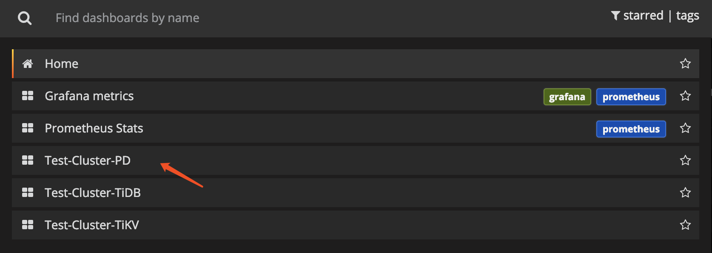

# TiDB 集群监控部署

本文档适用于希望手动部署 TiDB 监控报警系统的用户。TiUP 部署方式，会同时自动部署监控报警系统，无需手动部署。[TiDB Dashboard](/dashboard/dashboard-intro.md) 内置于 TiDB 的 PD 组件中，无需独立部署。

## 部署 Prometheus 和 Grafana

假设 TiDB 的拓扑结构如下：

| 节点  | 主机 IP | 服务 |
| :-- | :-- | :-------------- |
| Node1 | 192.168.199.113| PD1, TiDB, node_export, Prometheus, Grafana |
| Node2 | 192.168.199.114| PD2, node_export |
| Node3 | 192.168.199.115| PD3, node_export |
| Node4 | 192.168.199.116| TiKV1, node_export |
| Node5 | 192.168.199.117| TiKV2, node_export |
| Node6 | 192.168.199.118| TiKV3, node_export |

### 第 1 步：下载二进制包

下载二进制包：



```bash
wget https://github.com/prometheus/prometheus/releases/download/v2.49.1/prometheus-2.49.1.linux-amd64.tar.gz
wget https://download.pingcap.com/node_exporter-v1.3.1-linux-amd64.tar.gz
wget https://download.pingcap.com/grafana-7.5.17.linux-amd64.tar.gz
```

解压二进制包：



```bash
tar -xzf prometheus-2.49.1.linux-amd64.tar.gz
tar -xzf node_exporter-v1.3.1-linux-amd64.tar.gz
tar -xzf grafana-7.5.17.linux-amd64.tar.gz
```

### 第 2 步：在 Node1，Node2，Node3，Node4 上启动 `node_exporter`



```bash
cd node_exporter-v1.3.1-linux-amd64
```

启动 node_exporter 服务：



```bash
./node_exporter --web.listen-address=":9100" \
    --log.level="info" &
```

### 第 3 步：在 Node1 上启动 Prometheus

编辑 Prometheus 的配置文件：



```bash
cd prometheus-2.49.1.linux-amd64 &&
vi prometheus.yml
```

```ini
...

global:
  scrape_interval:     15s
  evaluation_interval: 15s
  # scrape_timeout 设置为全局默认值 (10s)
  external_labels:
    cluster: 'test-cluster'
    monitor: "prometheus"

scrape_configs:
  - job_name: 'overwritten-nodes'
    honor_labels: true  # 不要覆盖 job 和实例的 label
    static_configs:
    - targets:
      - '192.168.199.113:9100'
      - '192.168.199.114:9100'
      - '192.168.199.115:9100'
      - '192.168.199.116:9100'
      - '192.168.199.117:9100'
      - '192.168.199.118:9100'

  - job_name: 'tidb'
    honor_labels: true  # 不要覆盖 job 和实例的 label
    static_configs:
    - targets:
      - '192.168.199.113:10080'

  - job_name: 'pd'
    honor_labels: true  # 不要覆盖 job 和实例的 label
    static_configs:
    - targets:
      - '192.168.199.113:2379'
      - '192.168.199.114:2379'
      - '192.168.199.115:2379'

  - job_name: 'tikv'
    honor_labels: true  # 不要覆盖 job 和实例的 label
    static_configs:
    - targets:
      - '192.168.199.116:20180'
      - '192.168.199.117:20180'
      - '192.168.199.118:20180'

...
```

如需开启 TiDB、PD 和 TiKV 等组件的报警规则，请单独下载组件对应的报警规则文件，并在 Prometheus 的配置文件中添加报警规则文件的配置。

- TiDB：[`tidb.rules.yml`](https://github.com/pingcap/tidb/blob/master/pkg/metrics/alertmanager/tidb.rules.yml)
- PD：[`pd.rules.yml`](https://github.com/tikv/pd/blob/master/metrics/alertmanager/pd.rules.yml)
- TiKV：[`tikv.rules.yml`](https://github.com/tikv/tikv/blob/master/metrics/alertmanager/tikv.rules.yml)
- TiFlash：[`tiflash.rules.yml`](https://github.com/pingcap/tiflash/blob/master/metrics/alertmanager/tiflash.rules.yml)
- TiCDC：[`ticdc.rules.yml`](https://github.com/pingcap/tiflow/blob/master/metrics/alertmanager/ticdc.rules.yml)
- TiDB Lightning：[`lightning.rules.yml`](https://github.com/pingcap/tidb/blob/master/br/metrics/alertmanager/lightning.rules.yml)

```ini
rule_files:
  - 'tidb.rules.yml'
  - 'pd.rules.yml'
  - 'tikv.rules.yml'
  - 'tiflash.rules.yml'
  - 'ticdc.rules.yml'
  - 'lightning.rules.yml'
```

启动 Prometheus 服务：



```bash
./prometheus \
    --config.file="./prometheus.yml" \
    --web.listen-address="127.0.0.1:9090" \
    --web.external-url="http://127.0.0.1:9090/" \
    --log.level="info" \
    --storage.tsdb.path="./data.metrics" \
    --storage.tsdb.retention="15d" &
```

此示例仅监听本机回环地址，且不启用 Prometheus 管理 API。由于 Grafana 与 Prometheus 均部署在 Node1 上，Grafana 可以通过本机地址访问 Prometheus。如果需要从其他机器访问 Prometheus，请勿直接监听所有网络接口，而应通过受信任的管理网络以及启用 TLS 和身份验证的反向代理提供访问，并使用防火墙或安全组限制来源地址。

### 第 4 步：在 Node1 上启动 Grafana

编辑 Grafana 的配置文件：

```bash
cd grafana-7.5.17 &&
vi conf/grafana.ini
```

```ini
...

[paths]
data = ./data
logs = ./data/log
plugins = ./data/plugins
[server]
http_port = 3000
domain = 192.168.199.113
[database]
[session]
[analytics]
check_for_updates = true
[security]
admin_user = <grafana-admin-user>
admin_password = """<grafana-strong-password>"""
[snapshots]
[users]
[auth.anonymous]
[auth.basic]
[auth.ldap]
[smtp]
[emails]
[log]
mode = file
[log.console]
[log.file]
level = info
format = text
[log.syslog]
[event_publisher]
[dashboards.json]
enabled = false
path = ./data/dashboards
[metrics]
[grafana_net]
url = https://grafana.net

...

```

启动 Grafana 前，必须将 `<grafana-admin-user>` 和 `<grafana-strong-password>` 替换为自定义的管理员用户名和唯一的强密码。示例使用三个双引号包裹密码，以确保 `#` 和 `;` 被解析为密码字符而不是注释。不要使用 `admin` 作为密码，也不要将实际密码提交到版本控制系统。`admin_user` 和 `admin_password` 仅在首次启动并创建管理员账号时生效。对于已有的 Grafana 实例，请在 Grafana 中修改密码。

启动 Grafana 服务：



```bash
./bin/grafana-server \
    --config="./conf/grafana.ini" &
```

## 配置 Grafana

本小节介绍如何配置 Grafana。

### 第 1 步：添加 Prometheus 数据源

1. 登录 Grafana 界面。

    - 默认地址：`http://localhost:3000`
    - 管理员账户：首次创建管理员账号时使用 `[security]` 中配置的 `<grafana-admin-user>`；已有实例使用当前管理员账户
    - 管理员密码：首次创建管理员账号时使用 `[security]` 中配置的 `<grafana-strong-password>`；已有实例使用当前管理员密码

    > **注意：**
    >
    > 如果 Grafana 提示执行 **Change Password** 步骤，必须设置新的唯一强密码，不要选择 **Skip**。

2. 点击 Grafana 侧边栏菜单 **Configuration** 中的 **Data Source**。

3. 点击 **Add data source**。

4. 指定数据源的相关信息：

    - 在 **Name** 处，为数据源指定一个名称。
    - 在 **Type** 处，选择 **Prometheus**。
    - 在 **URL** 处，指定 Prometheus 的 IP 地址。
    - 根据需求指定其它字段。

5. 点击 **Add** 保存新的数据源。

### 第 2 步：导入 Grafana 面板

执行以下步骤，为 PD Server、TiKV Server 和 TiDB Server 分别导入 Grafana 面板：

1. 点击侧边栏的 Grafana 图标。

2. 在侧边栏菜单中，依次点击 **Dashboards** > **Import** 打开 **Import Dashboard** 窗口。

3. 点击 **Upload .json File** 上传对应的 JSON 文件（从 [pingcap/tidb](https://github.com/pingcap/tidb/tree/master/pkg/metrics/grafana)、[tikv/tikv](https://github.com/tikv/tikv/tree/master/metrics/grafana) 和 [tikv/pd](https://github.com/tikv/pd/tree/master/metrics/grafana) 下载 TiDB Grafana 配置文件）。

    > **注意：**
    >
    > TiKV、PD 和 TiDB 面板对应的 JSON 文件分别为 `tikv_summary.json`，`tikv_details.json`，`tikv_trouble_shooting.json`，`pd.json`，`tidb.json`，`tidb_summary.json`。

4. 点击 **Load**。

5. 选择一个 Prometheus 数据源。

6. 点击 **Import**，Prometheus 面板即导入成功。

## 查看组件 metrics

在顶部菜单中，点击 **New dashboard**，选择要查看的面板。



可查看以下集群组件信息：

+ **TiDB Server:**
    + query 处理时间，可以看到延迟和吞吐
    + ddl 过程监控
    + TiKV client 相关的监控
    + PD client 相关的监控

+ **PD Server:**
    + 命令执行的总次数
    + 某个命令执行失败的总次数
    + 某个命令执行成功的耗时统计
    + 某个命令执行失败的耗时统计
    + 某个命令执行完成并返回结果的耗时统计

+ **TiKV Server:**
    + GC 监控
    + 执行 KV 命令的总次数
    + Scheduler 执行命令的耗时统计
    + Raft propose 命令的总次数
    + Raft 执行命令的耗时统计
    + Raft 执行命令失败的总次数
    + Raft 处理 ready 状态的总次数
